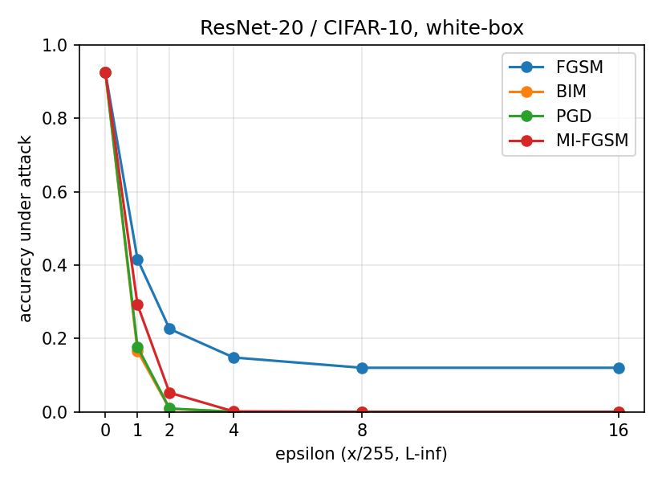
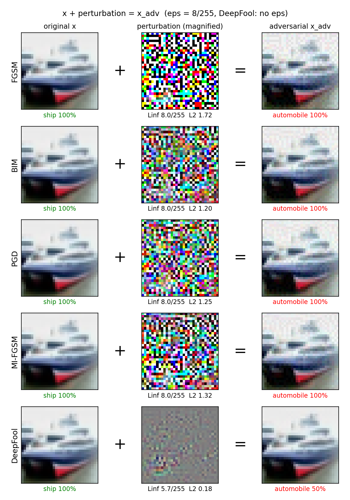
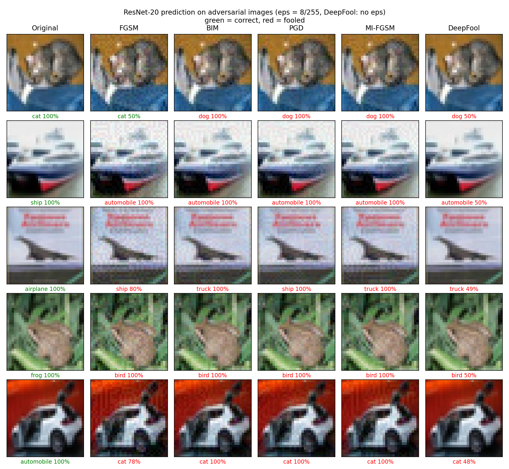
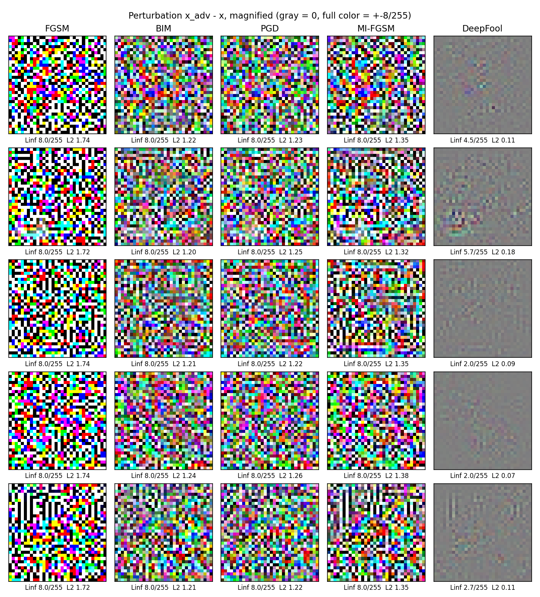

# FGSM 후속 적대적 공격 기법 사례 분석

FGSM과 그 한계를 개선한 후속 기법 4개(BIM, PGD, MI-FGSM, DeepFool)를 직접 구현하고, 같은 모델과 같은 데이터에서 비교했다.

- **데이터셋:** CIFAR-10. 모델 학습에는 학습셋, 공격 실험에는 테스트셋 앞 1,000장을 썼다(아래 데이터셋 분할)
- **공격 대상 모델:** ResNet-20. CIFAR-10 학습셋 전체로 학습(100에폭, 증강 사용), 깨끗한 정확도 92.5%. 학습은 엘리스 클라우드의 A100 GPU에서 했다(아래 실험 환경)
- **전이 대상 모델:** 같은 구조, 다른 시드로 학습한 ResNet-20 2개(`s1`, `s2`)
- **공격 조건:** 비표적(untargeted), L∞ 제약, 입력 범위 [0, 1]. 반복형 공격은 10스텝

## 데이터셋 분할

CIFAR-10 공식 분할(학습 50,000장 / 테스트 10,000장, 클래스당 5,000 / 1,000장)을 그대로 썼다.

| 용도 | 사용한 데이터 | 장 수 | 쓰인 곳 |
|---|---|---|---|
| 학습 (train) | CIFAR-10 학습셋 전체 | 50,000 | 모델 3개(`s0`, `s1`, `s2`) 학습. 증강은 여기에만 적용 |
| 검증 (validation) | 없음 | 0 | 하이퍼파라미터를 튜닝하지 않고 CIFAR-10 표준 레시피를 그대로 써서 따로 떼지 않았다 |
| 테스트 (test) | CIFAR-10 테스트셋 전체 | 10,000 | 학습이 끝난 모델의 깨끗한 정확도 확인(`s0` 91.97%) |
| 공격 실험 | CIFAR-10 테스트셋 앞 1,000장 (인덱스 0~999, 고정) | 1,000 | `run.py`의 실험 1~3 전부. 모든 공격·모든 ε에 같은 1,000장 |
| 그림 | 위 1,000장 중 `s0`이 맞힌 이미지를 클래스별로 하나씩 (인덱스 0, 1, 3, 4, 6) | 5 | `viz.py`의 그림 3장 |

- 공격에 쓴 이미지는 모두 **학습에 쓰지 않은** 테스트셋 이미지다. 모델이 외운 이미지를 공격한 것이 아니다.
- 공격 실험 1,000장은 테스트셋의 일부다. 테스트셋은 모델 정확도 확인에만 썼고 학습이나 설정 선택에는 쓰지 않았으므로, 같은 이미지를 공격에 써도 결과가 유리하게 치우치지 않는다.
- 앞 1,000장의 클래스별 장 수는 airplane 103, automobile 89, bird 100, cat 103, deer 90, dog 86, frog 112, horse 102, ship 106, truck 109로, 클래스당 86~112장이라 한쪽으로 치우치지 않았다.

## 구현한 기법

| 기법 | 핵심 아이디어 | FGSM의 어떤 한계를 고쳤나 |
|---|---|---|
| **FGSM** (Goodfellow+, 2015) | 손실 기울기의 부호로 ε만큼 한 번 이동 | (기준) |
| **BIM / I-FGSM** (Kurakin+, 2017) | 작은 스텝으로 FGSM을 반복하고, 매번 ε 공 안으로 자름 | 한 번의 선형 근사는 곡면인 손실을 잘 못 따라감 |
| **PGD** (Madry+, 2018) | BIM + ε 공 안 무작위 시작점 | 시작점이 하나라 나쁜 국소해에 걸릴 수 있음 |
| **MI-FGSM** (Dong+, 2018) | 정규화한 기울기에 모멘텀을 누적 | 반복형 공격은 대상 모델에 과적합되어 다른 모델로 전이가 약함 |
| **DeepFool** (Moosavi-Dezfooli+, 2016) | 선형화한 가장 가까운 결정경계까지의 최소 L2 이동 | ε를 미리 정해야 하고, 필요 이상으로 크게 바꿈 |

코드는 `src/attacks.py` 한 파일에 있다.

## 결과

### 1. 공격 성능 곡선 (ε별 공격 후 정확도, 화이트박스)

같은 모델에 ε를 키워 가며 공격하고, 정확도가 얼마나 떨어지는지 본 곡선이다. **곡선이 빨리, 낮게 떨어질수록 강한 공격이다.**



| ε (/255) | 0 | 1 | 2 | 4 | 8 | 16 |
|---|---|---|---|---|---|---|
| FGSM | 0.925 | 0.416 | 0.226 | 0.148 | **0.120** | **0.120** |
| BIM | 0.925 | 0.166 | 0.008 | 0.000 | 0.000 | 0.000 |
| PGD | 0.925 | 0.177 | 0.009 | 0.000 | 0.000 | 0.000 |
| MI-FGSM | 0.925 | 0.292 | 0.052 | 0.001 | 0.000 | 0.000 |

### 2. ε = 8/255에서 비용·전이성·이동량

| 기법 | 기울기 계산 수 | 시간 (s / 1000장, Apple MPS) | 화이트박스 정확도 | 전이 정확도 s1 | 전이 정확도 s2 | 평균 L2 이동량 |
|---|---|---|---|---|---|---|
| FGSM | 1 | 0.46 | 0.120 | 0.319 | 0.302 | 1.72 |
| BIM | 10 | 4.49 | 0.000 | **0.075** | **0.072** | 1.19 |
| PGD | 10 | 4.51 | 0.000 | 0.091 | 0.080 | 1.22 |
| MI-FGSM | 10 | 4.57 | 0.000 | 0.076 | 0.076 | 1.31 |

전이 정확도는 공격 대상 모델(s0)로 만든 적대적 예제를 다른 모델(s1, s2)에 넣었을 때의 정확도다. 낮을수록 전이가 잘 된 것이다.

### 3. DeepFool (ε 없이 최소 이동)

| 원래 맞힌 이미지 | 공격 성공 | 이동량 L2 중앙값 | 이동량 L∞ 중앙값 | 시간 (s / 1000장) |
|---|---|---|---|---|
| 925 | 925 (100%) | **0.097** | 3.15 / 255 | 22.1 |

### 4. 실제 이미지에서 보기

공격 대상 모델이 원래 맞힌 테스트 이미지를 클래스별로 하나씩 5장 골라(앞 1,000장 안에서), 같은 조건(ε = 8/255, DeepFool은 ε 없음)으로 공격한 결과다. 그림의 예측과 수치는 모두 실제로 공격을 돌려 모델에 넣은 값이다.

**원본 + 섭동 = 적대적 예제.** 사람 눈에는 거의 같은 배 사진인데, 모델은 automobile로 바꿔 읽는다. 가운데 섭동은 ±8/255를 화면 전체 밝기로 늘려 보이게 한 것이다(회색 = 변화 없음).



**5장 이미지에 대한 공격 결과.** 초록은 여전히 맞힘, 빨강은 속음.



- 첫 줄 고양이는 FGSM으로 속지 않지만(cat 50%), 반복형 공격에는 모두 dog 100%로 속는다. 실험 1에서 FGSM 정확도가 12% 아래로 내려가지 않은 것의 실제 사례다.
- DeepFool로 만든 예제는 확신도가 전부 50% 안팎이다. 결정경계를 막 넘는 데까지만 움직이기 때문이다.

**섭동만 따로 본 것.** 같은 배율이라 색이 진할수록 많이 바꾼 것이다.



- FGSM은 모든 픽셀을 ±ε 끝까지 밀어서 거의 원색만 보인다(L2 약 1.73).
- BIM·PGD는 중간 값이 섞여 있어 덜 움직인다(L2 약 1.2). 그런데도 더 강하다.
- DeepFool은 거의 회색이다(L2 0.07~0.18). 꼭 필요한 만큼만 바꾼다.

## 분석: 강점과 한계

**FGSM**
- 강점: 기울기 한 번이라 가장 빠르다(반복형보다 약 10배 빠름). ε가 작을 때도 정확도를 92.5%에서 41.6%(ε=1/255)로 크게 떨어뜨린다.
- 한계: **ε를 키워도 정확도가 12%에서 더 내려가지 않는다**(8/255와 16/255가 같음). 한 번의 선형 근사로 방향을 정하니, 손실 곡면이 휘어 있는 이미지는 ε를 키워도 경계를 넘지 못한다. L2 이동량은 가장 큰데(1.72) 효과는 가장 약하다.

**BIM / PGD**
- 강점: 작은 스텝으로 곡면을 따라가서 ε=4/255에서 정확도 0%를 만든다. FGSM보다 **적게 움직이고**(L2 1.19~1.22) 더 강하다.
- 한계: 비용이 스텝 수만큼(10배) 든다. 이 실험(일반 학습 모델)에서는 PGD의 무작위 시작이 BIM보다 나은 점이 보이지 않았다. 무작위 시작은 적대적 학습으로 손실 곡면이 울퉁불퉁해진 모델에서 의미가 크다.

**MI-FGSM**
- 강점: 화이트박스에서 ε=4/255 이상이면 BIM·PGD와 같이 0%이다.
- 한계: 작은 ε에서는 BIM·PGD보다 약하다(ε=2/255에서 5.2% vs 0.8~0.9%). 스텝 크기를 ε/10으로 고정해서 같은 스텝 수로 덜 움직이기 때문이다. 원래 장점인 전이성은 이 실험에서 BIM과 같은 수준이었다. 전이 대상이 같은 구조라 모든 반복형 공격이 잘 전이되었기 때문으로 보인다. 다른 구조로 전이하면 차이가 날 수 있다.

**DeepFool**
- 강점: 모든 이미지를 속이면서 L2 이동량 중앙값이 0.097이다. ε=8/255 공격들의 평균 L2(1.2~1.7)보다 **10배 이상 작다.** "이 모델이 얼마나 약한가"(최소 섭동 크기)를 재는 데 적합하다.
- 한계: 클래스마다 기울기를 따로 구해서 가장 느리다(22초, FGSM의 약 50배). L∞ 제약이 없어서 일부 픽셀은 3/255 넘게 바뀐다. 최소 경계만 넘기 때문에 확신도가 낮은 적대적 예제가 나온다.

## 실험 환경

모델 학습과 공격 실험을 서로 다른 장비에서 했다.

**모델 학습: 엘리스(Elice) 클라우드에서 빌린 NVIDIA A100 GPU**
- 일반 학습(cross-entropy만 쓰는 baseline)이다. 적대적 학습 같은 방어는 하지 않았다.
- 학습 코드는 `scripts/train.py`이다. 시드 0, 1, 2로 각각 학습한 것이 `s0`, `s1`, `s2`이다.
- 학습 조건: CIFAR-10 학습셋 50,000장, 100에폭, 배치 128, SGD(momentum 0.9, Nesterov), lr 0.05 + 코사인 스케줄, weight decay 5e-4, 증강(RandomCrop 32 padding 4 + 좌우 뒤집기), 입력 정규화 없음([0, 1])
- 학습 시간: 모델 하나에 약 20~25분
- 테스트셋 10,000장 전체에서 `s0`의 깨끗한 정확도는 91.97%, FGSM(ε=8/255) 후 12.7%, PGD-10 후 0%였다. 이 저장소의 1,000장 결과(92.5%, 12.0%, 0%)와 거의 같다.

**공격 실험: 로컬 맥**
- Apple M3, 메모리 16GB, macOS 26.6, PyTorch 2.12 (Apple MPS)
- `run.py` 전체 실행 약 2분. 표의 시간도 이 장비 기준이다.

## 이 실험의 범위와 한계

- 모델 1개(일반 학습 ResNet-20), 이미지 1,000장. 적대적 학습으로 방어한 모델은 다루지 않았다.
- 전이성은 같은 구조끼리만 쟀다.
- C&W, AutoAttack 같은 다른 후속 기법은 구현하지 않았다.
- Apple MPS에서 실행했다. 다른 장치에서는 PGD 무작위 시작 등의 이유로 소수점 셋째 자리 정도 달라질 수 있다.

## 실행 방법

```bash
pip install -r requirements.txt
python scripts/run.py                    # CIFAR-10을 ./data에 내려받는다
python scripts/run.py --data_root PATH   # 이미 받은 CIFAR-10 폴더를 쓸 때
python scripts/viz.py --data_root PATH   # 실제 이미지 그림 3장
python scripts/train.py --seed 0 --data_root PATH   # 공격 대상 모델을 직접 다시 학습할 때 (GPU 권장)
```

`scripts/train.py`는 `checkpoints/trained_s{시드}.pt`로 저장하므로 기존 체크포인트를 덮어쓰지 않는다. 장비와 데이터 로딩 순서가 달라서 기존 체크포인트와 가중치가 똑같이 나오지는 않는다.

표는 `results/tables/`, 그림은 `results/figures/`에 저장된다. 어느 폴더에서 실행해도 저장소 기준 경로에 저장된다.

## 파일 구성

```
src/
  attacks.py      FGSM, BIM, PGD, MI-FGSM, DeepFool 구현
  models.py       ResNet-20 정의와 체크포인트 불러오기
scripts/
  train.py        ResNet-20 학습 (공격 대상 모델을 만드는 코드)
  run.py          전체 공격 실험 실행 → results/tables/*.csv, results/figures/attack_curve.png
  viz.py          실제 이미지에 공격한 결과 그림 → results/figures/
checkpoints/      학습된 ResNet-20 3개 (s0 = 공격 대상, s1·s2 = 전이 대상)
results/
  tables/         curve.csv, eps8_summary.csv, deepfool.csv
  figures/        attack_curve.png, how_it_works.png, adv_examples.png, perturbations.png
```
